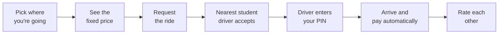

<div align="center">


# UniHop

### Campus rides by students, for students. Every ride under $10.

UniHop is a ride-sharing app made only for Rutgers. You pick a campus stop, see the exact price before you book,<br/>
and a fellow student with a car picks you up. No surge pricing, no strangers, no surprises.

**Rutgers–New Brunswick** · **Works on any phone** · **Built in 24 hours**

</div>

---

## Why UniHop?

Getting between College Ave, Busch, Livingston, Cook/Douglass and downtown New Brunswick is a daily hassle. The buses are packed, and Uber or Lyft is expensive for a ten-minute hop.

UniHop fixes that:

| | |
|---|---|
| **Always under $10** | Every trip has one fixed price, shown before you book. It never surges. |
| **Students only** | You sign in with your Rutgers scarletmail address, so every rider and driver is a fellow student. |
| **Campus stops** | Pickups and drop-offs happen at six well-known campus hubs, so no one gets lost. |
| **PIN-protected pickup** | You get a 4-digit PIN. The trip only starts once your driver enters it, so you know you're in the right car. |
| **Pay your way** | Cards, Apple Pay, Google Pay, or **UniHop Cash** (prepaid credit). You're only charged when the ride ends. |
| **Drivers keep 90%** | Students who drive keep 90% of every base fare and can cash out instantly. |

---

## How a ride works



1. **Choose your stop.** Your pickup is the nearest campus hub, and you tap where you want to go.
2. **See the price.** The fare is fixed by which campuses you're travelling between. What you see is what you pay.
3. **Request.** UniHop holds the fare on your card or UniHop Cash. Nothing is charged yet.
4. **Get matched.** The closest available student driver gets your request and has 15 seconds to accept. If they pass, it goes to the next closest.
5. **Meet your driver.** You watch the car move on the map in real time and see the driver's name, car and plate.
6. **Share your PIN.** The driver types in your 4-digit PIN to start the trip.
7. **Arrive.** The ride ends, you're charged, the driver is paid, and you both get a receipt and can rate each other.

**Plans change?** Cancel before the trip starts and you're never charged; the hold is released and any UniHop Cash goes straight back. If no driver is free, you're told right away and not charged.

---

## Prices

Every ride has one fixed price, shown before you book. There is no surge pricing and no meter: the price depends only on which campus you are going from and to.

### 1. The price table

Each of the six stops belongs to a campus zone. The fare is looked up from this table using the pickup zone and the drop-off zone, and it is the same in both directions.

| From ↓ / To → | College Ave | Busch | Livingston | Cook / Douglass | Downtown |
|---|:---:|:---:|:---:|:---:|:---:|
| **College Ave** | $4.50 | $6.50 | $6.50 | $6.50 | $4.50 |
| **Busch** | $6.50 | $4.50 | $5.50 | $8.50 | $6.50 |
| **Livingston** | $6.50 | $5.50 | $4.50 | $8.50 | $6.50 |
| **Cook / Douglass** | $6.50 | $8.50 | $8.50 | $4.50 | $5.50 |
| **Downtown** | $4.50 | $6.50 | $6.50 | $5.50 | $4.50 |

- **Same zone, different stop** (for example Cook Campus Center to Douglass Student Center) costs $4.50.
- **The same stop** for pickup and drop-off is not allowed.
- **Every fare is under $10.**

**The six stops:** The Yard (College Ave) · Busch Student Center · Livingston Student Center · Cook Campus Center · Douglass Student Center · New Brunswick Station (Downtown)

### 2. How each fare is split

```
platform fee     = $1.50 (fixed, every ride)
base fare        = total - $1.50
driver earns     = 90% of the base fare
UniHop keeps     = total - driver earns   (the $1.50 fee plus 10% of the base fare)
```

All amounts are rounded to the nearest cent.

| Rider pays | Base fare | Driver earns | UniHop keeps |
|---|---|---|---|
| $4.50 | $3.00 | **$2.70** | $1.80 |
| $5.50 | $4.00 | **$3.60** | $1.90 |
| $6.50 | $5.00 | **$4.50** | $2.00 |
| $8.50 | $7.00 | **$6.30** | $2.20 |

### 3. How the rider pays

UniHop Cash (prepaid credit) is used first when the rider turns it on, and only the rest goes on their card, Apple Pay or Google Pay. Nothing is charged until the ride ends. A cancelled ride, or a ride with no driver available, costs nothing.

---

## For drivers

- **Sign up in a minute.** Switch to **Drive**, add your licence and car, and you're approved instantly (for the demo).
- **Go online** whenever you have time between classes.
- **Get requests nearby.** You see the pickup, drop-off, the rider's rating and exactly what you'll earn, then accept or decline.
- **Earnings in real time.** Today, this week and all-time totals, with **instant cash out** to your debit card at no fee.

---

## Try it yourself

> Everything below is a **demo**. No real money moves and no real cards are charged.

**1. Open the app.** Ask a teammate to start it (see [For developers](#for-developers)), then open **http://localhost:3000**. On a phone, use the laptop's network address instead and add it to your home screen; it installs like a normal app.

**2. Sign in.** Type one of these NetIDs and tap **Send code**. The app shows you the code, so just tap **Use it**.

| Sign in as | Who they are |
|---|---|
| `rider1` | **Jordan**, a rider with a saved Visa card, Apple Pay and $5.00 of UniHop Cash |
| `rider2` | **Sam**, a rider with a Mastercard plus an old card that gets **declined** (good for testing what happens) |
| `driver1` | **Alex**, a driver in a Blue Honda Civic near The Yard |

There are four more demo drivers parked around campus. Unless someone is signed in as them, they **drive themselves**: they accept your ride after about 3 seconds and complete the whole trip, so one person can try UniHop alone.

**3. Want to add a card?** Use these pretend card numbers, with any future expiry date and any 3-digit security code:

| Card number | What happens |
|---|---|
| 4242 4242 4242 4242 | Works (Visa) |
| 5555 5555 5555 4444 | Works (Mastercard) |
| 4000 0000 0000 0002 | Gets declined when you use it |

---

## Who built it

UniHop was built by three Rutgers students in a 24-hour hackathon.

| | Built |
|---|---|
| **Tanay Desai** ([@TanayDesai-1510](https://github.com/TanayDesai-1510)) | The app you see: every screen, the map, the design and the phone experience |
| **Hriday** ([@hriday1136](https://github.com/hriday1136)) | Sign-in, accounts, driver sign-up, pricing, payments, UniHop Cash, earnings, ratings and receipts |
| **Dev Amin** ([@DAmin05](https://github.com/DAmin05)) | Rides and matching, live tracking, the self-driving demo drivers and the end-to-end test |

---

## For developers

<details>
<summary><b>Tech stack</b></summary>

- **App (frontend):** Next.js 16 with React 19, TypeScript and Tailwind 4; Leaflet maps; live updates over STOMP WebSockets. It's an installable PWA designed mobile-first.
- **Server (backend):** Java 21 and Spring Boot 3.5, PostgreSQL 16 with Flyway, Spring Security with JWT, STOMP over WebSocket, and Swagger docs.
- **Payments:** a built-in mock processor that behaves like Stripe (tokenization, holds, capture, void, payouts), so it could be swapped for the real thing later.

</details>

<details>
<summary><b>Run it locally</b></summary>

1. Install **Docker Desktop** and **Git**.
2. Install Java 21 and Node 22:
   - **Mac:** install [mise](https://mise.jdx.dev), then run `mise install` in the repo (it reads `.mise.toml`).
   - **Windows:** `winget install EclipseAdoptium.Temurin.21.JDK` and `winget install OpenJS.NodeJS --version 22`, then restart your terminal. **Use Git Bash for every command below.**
   - Check: `java -version` shows 21 and `node -v` shows v22.
3. Clone and configure:
   ```bash
   gh repo clone TanayDesai-1510/unihop && cd unihop
   cp .env.example .env
   cp frontend/.env.example frontend/.env.local
   (cd frontend && npm ci)
   ```
4. Run everything (Postgres in Docker, backend on :8080, frontend on :3000):
   ```bash
   ./start.sh
   ```

| What | URL |
|---|---|
| App | http://localhost:3000 |
| Swagger UI | http://localhost:8080/swagger-ui.html |
| Health | http://localhost:8080/api/health |

**Mocks vs. the real backend:** the frontend uses built-in mocks while `NEXT_PUBLIC_USE_MOCKS=true` in `frontend/.env.local` (the default in `.env.example`). Set it to `false` to use the real backend, then restart the frontend. In mock mode the OTP is always `123456`.

**Phones on the same Wi-Fi:** see [frontend/INTEGRATION.md](frontend/INTEGRATION.md). It covers the LAN IP, `CORS_ORIGINS` and Demo GPS.

**Useful commands**

```bash
cd backend && ./mvnw test                 # backend tests (no Docker needed)
cd frontend && npm run build && npm run lint
scripts/smoke.sh                          # golden-path end-to-end check against a running backend
docker compose -f .devcontainer/docker-compose.yml down -v   # reset the database to the seed data
```

The demo drivers are controlled by `app.simulator.enabled` (on by default). Turn it off with `APP_SIMULATOR_ENABLED=false` when you want a real phone to receive the offers.

</details>

<details>
<summary><b>All demo accounts and test cards</b></summary>

Log in with any of these emails. The OTP is shown on screen (`devOtp`); in mock mode it is always `123456`.

| Account | Email | UUID (for `X-Demo-User`) |
|---|---|---|
| rider1 (Visa 4242 default + Apple Pay, $5.00 UniHop Cash) | rider1@scarletmail.rutgers.edu | `00000000-0000-0000-0000-000000000101` |
| rider2 (Mastercard 4444 default + declining "Old card" 0002) | rider2@scarletmail.rutgers.edu | `00000000-0000-0000-0000-000000000102` |
| driver1 (Blue Honda Civic, near The Yard) | driver1@scarletmail.rutgers.edu | `00000000-0000-0000-0000-000000000201` |
| driver2 (Silver Toyota Camry, near Busch) | driver2@scarletmail.rutgers.edu | `00000000-0000-0000-0000-000000000202` |
| driver3 (White Hyundai Elantra, near Livingston) | driver3@scarletmail.rutgers.edu | `00000000-0000-0000-0000-000000000203` |
| driver4 (Gray Toyota Prius, near Cook) | driver4@scarletmail.rutgers.edu | `00000000-0000-0000-0000-000000000204` |
| driver5 (Black Honda Accord, near NB Station) | driver5@scarletmail.rutgers.edu | `00000000-0000-0000-0000-000000000205` |

Backend testing without a JWT (while `app.auth.demo-header=true`):

```bash
curl -H "X-Demo-User: 00000000-0000-0000-0000-000000000101" http://localhost:8080/api/users/me
```

Hub, payment-method and credit UUIDs are in [contract section 7](docs/contract.md#7-seed-data-v2-and-fixed-uuids).

Test cards: any future expiry works, and the CVC is 3 digits (4 for Amex). Declines happen when the card is used, not when it's saved.

| Number | Brand | Behavior |
|---|---|---|
| 4242 4242 4242 4242 | Visa | Success |
| 5555 5555 5555 4444 | Mastercard | Success |
| 3782 822463 10005 | Amex | Success (4-digit CVC) |
| 6011 1111 1111 1117 | Discover | Success |
| 4000 0000 0000 0002 | Visa | Declined: `CARD_DECLINED` |
| 4000 0000 0000 9995 | Visa | Declined: `INSUFFICIENT_FUNDS` |
| 4000 0000 0000 0069 | Visa | Declined: `EXPIRED_CARD` |
| 4000 0000 0000 0127 | Visa | Declined: `INCORRECT_CVC` |

Any other Luhn-valid number succeeds. A bad Luhn number, a past expiry or the wrong CVC length is rejected when tokenizing (`INVALID_NUMBER`, `INVALID_EXPIRY`, `INVALID_CVC`).

</details>

<details>
<summary><b>Project docs and code ownership</b></summary>

- **Contract (source of truth for every API, table and event):** [docs/contract.md](docs/contract.md)
- **Agent rules:** [CLAUDE.md](CLAUDE.md) (identical copy in [AGENTS.md](AGENTS.md) for Codex)
- **First prompt for your agent:** [docs/kickoff.md](docs/kickoff.md)
- **Frontend ↔ backend test checklist:** [frontend/INTEGRATION.md](frontend/INTEGRATION.md)

| Person | Owns |
|---|---|
| Tanay (TanayDesai-1510) | `frontend/`, integration, demo, frontend deploy |
| Hriday (hriday1136) | Backend platform: auth, user, driver, pricing, payments, mockpay, rating, records, admin |
| Dev (DAmin05) | Backend realtime: ride, matching, realtime, simulator, `scripts/smoke.sh`, backend deploy |

</details>
